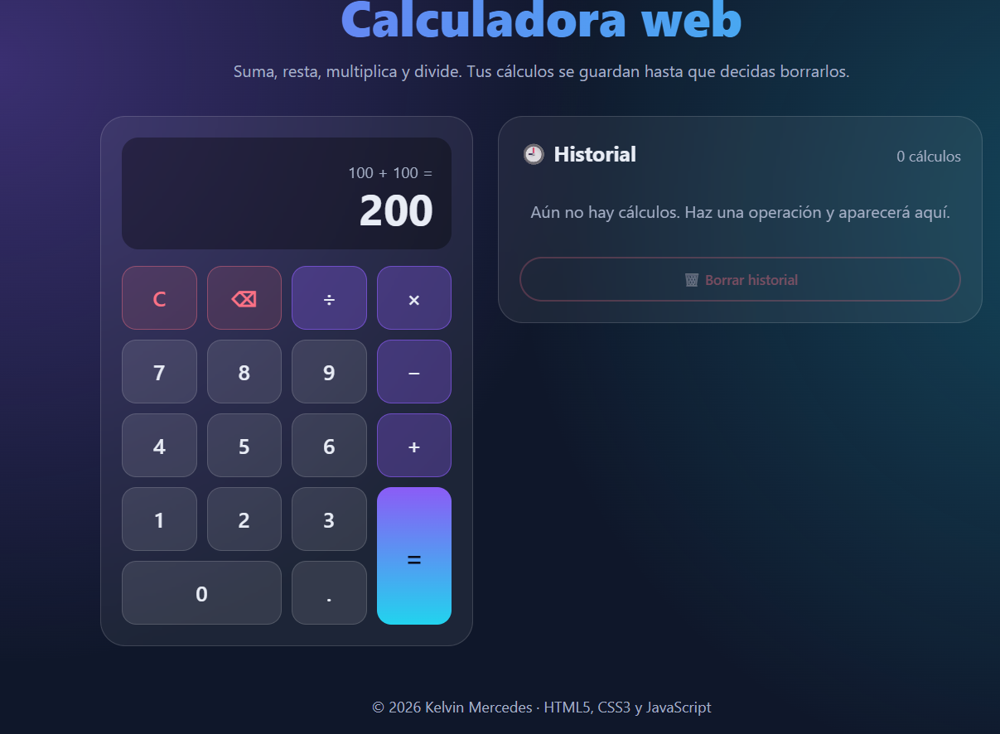
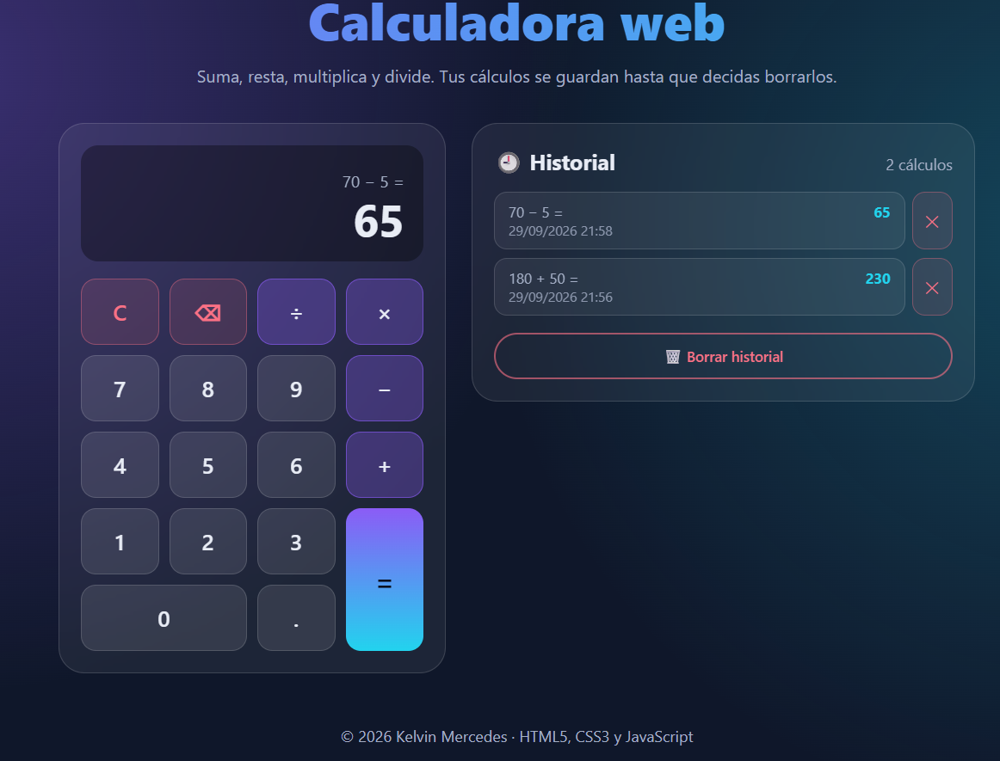
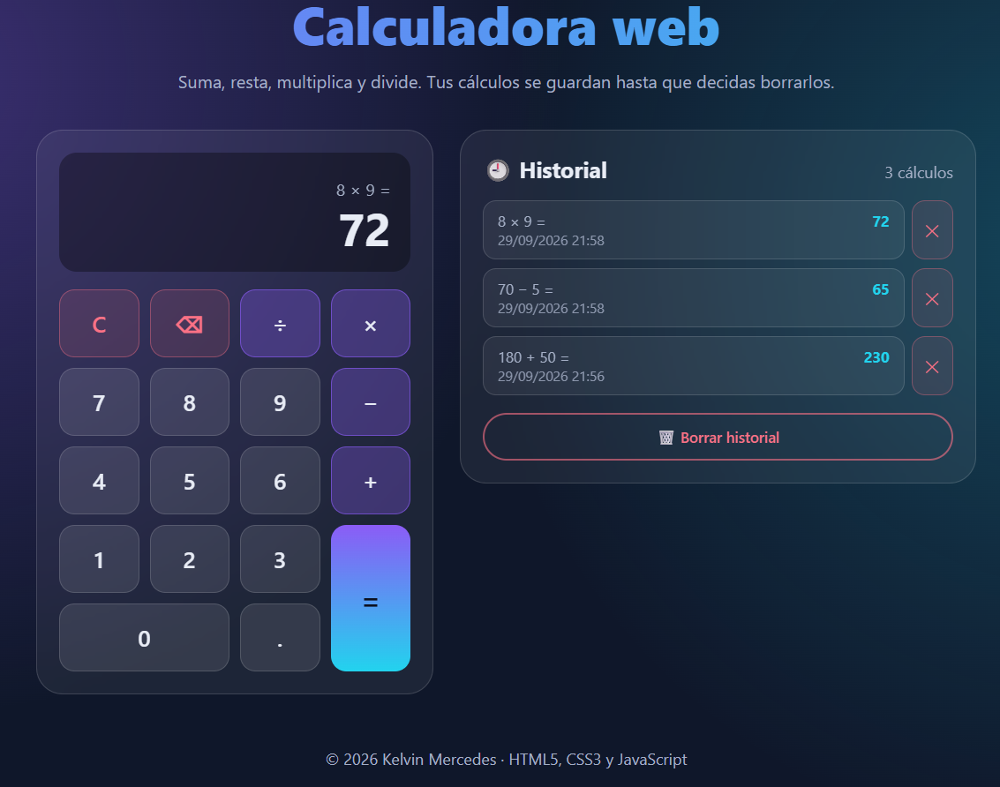
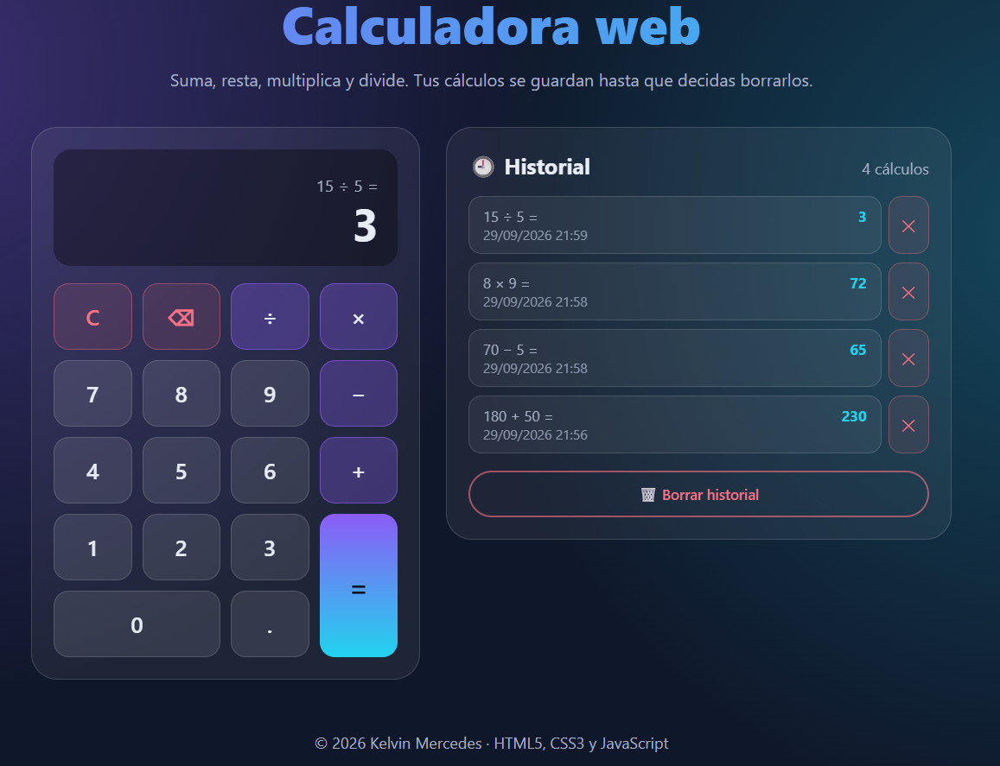
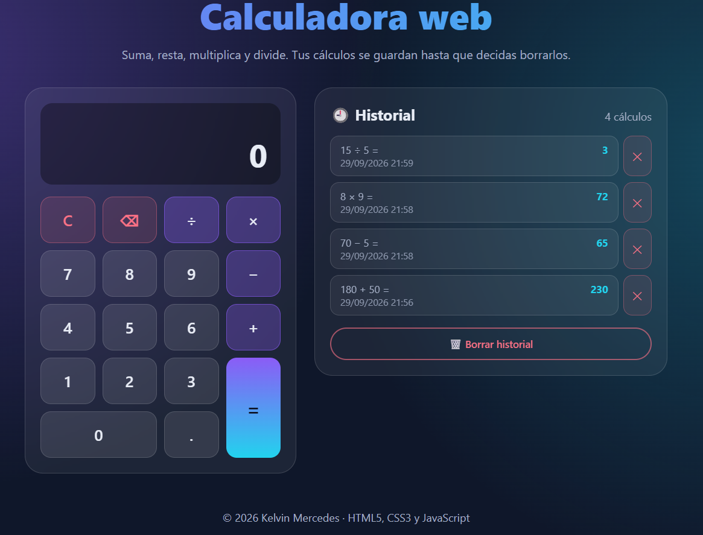

# Calculadora web

Tarea 2: calculadora web hecha con HTML5, CSS3 y JavaScript (ES5).

**Autor:** Kelvin Mercedes
**Institución:** Instituto Tecnológico de las Américas (ITLA)

## Descripción

Calculadora de una sola pantalla con diseño oscuro, degradados y tarjetas. Realiza las cuatro operaciones básicas y guarda un historial de los cálculos hechos, que se conserva aunque se cierre el navegador y solo se elimina cuando el usuario lo decide.

## Elementos incluidos

| Requisito | Dónde está |
|---|---|
| Suma, resta, multiplicación y división | Teclado de la calculadora (`+`, `−`, `×`, `÷`) |
| Historial de cálculos | Panel "Historial", con la operación, el resultado y la fecha |
| Historial guardado con localStorage | Clave `historialCalculadora`, se carga al abrir la página |
| Eliminar el historial | Botón "Borrar historial" (con confirmación) y botón ✕ para quitar un cálculo |
| Decoración con CSS3 | Degradados, tarjetas de cristal, botones con efectos y diseño adaptable a celular |
| Extras | Punto decimal, botón `C`, botón `⌫`, uso del teclado y aviso al dividir entre 0 |

## Tecnologías

- HTML5
- CSS3 (variables, grid, flexbox, degradados, diseño adaptable a celular)
- JavaScript ES5 (`var` y `function`) y `localStorage`

## Estructura del proyecto

```
calculadora-web/
├── index.html         # Estructura de la calculadora y del historial
├── estilos.css        # Estilos y diseño
├── calculadora.js     # Lógica de la calculadora y manejo de localStorage
└── README.md          # Este archivo
```

## Cómo ejecutarlo

1. Descarga o clona la carpeta `calculadora-web`.
2. Ábrela en Visual Studio Code.
3. Haz clic derecho en `index.html` y elige **Open with Live Server** (extensión Live Server), o abre `index.html` directamente en el navegador.

## Capturas del proyecto en funcionamiento

### Calculadora
<!-- Arrastra aquí la captura de la calculadora con una operación en pantalla -->

### Historial de cálculos
<!-- Arrastra aquí la captura del historial con varios cálculos -->




### Historial guardado en localStorage
<!-- Arrastra aquí la captura de F12 > Application > Local Storage > historialCalculadora -->
